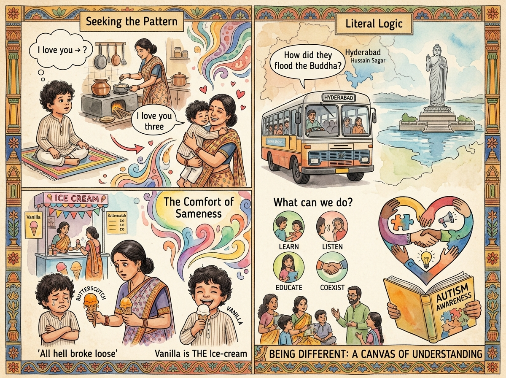

What does it mean when we say, 'Autism is Being different'?

It could mean different ways of feeling the world, different ways of seeing the world and different ways one responds to the world.

In a purely language sense, there cannot be an exclusive way to sense the world. In a mathematical sense, there can be infinite ways to feel, see and respond to the world.
I want to share some snippets.

1. The child is a 3-year-old boy with Autism. He had figured that his mom would pick him when he says, 'I love you'. He tried that.
She was busy with something. So, she said, ' I love you too'.
That's it. He was very distressed as it wasn't the expected response.
But he seeks out the pattern and says, 'I love you three'.
Bingo! This worked better than the first one. The mom picked him up and showered all her love.

2. The 3-year-old child loved to have ice cream. So, the mom and son would finish their therapy session, and he would have a Vanilla scoop every day. He looked forward to it.
One day, he did really well at therapy. So, the mother bought him a Butterscotch scoop. She loved that flavour and it was more expensive.

All hell broke loose. The child cried for half an hour.
The mother was in tears. Her child was refusing to have his most favourite thing.
The ice cream melted. She threw it away.

After he calmed down, they went to the shop, and he pointed to the ice cream. The shopkeeper gave Vanilla out of habit. The child was ecstatic.
That's it! Vanilla is The Ice-cream. Nothing else is.

3. A 7-year-old child was traveling in a bus in Hyderabad. He saw the Buddha in Hussain Sagar and asked his mother, 'How did they flood the Buddha?'

These kinds of experiences happen everyday, in almost every instance of interaction for an autistic person.

Some of these may sound cute and exotic.

However, it's incredibly hard for an autistic person to go through the day, to be heard and understood and to understand others.

What can we do?

We can definitely learn more about Autism, listen to people on the spectrum, educate ourselves to understand better and do our best to coexist peacefully.

