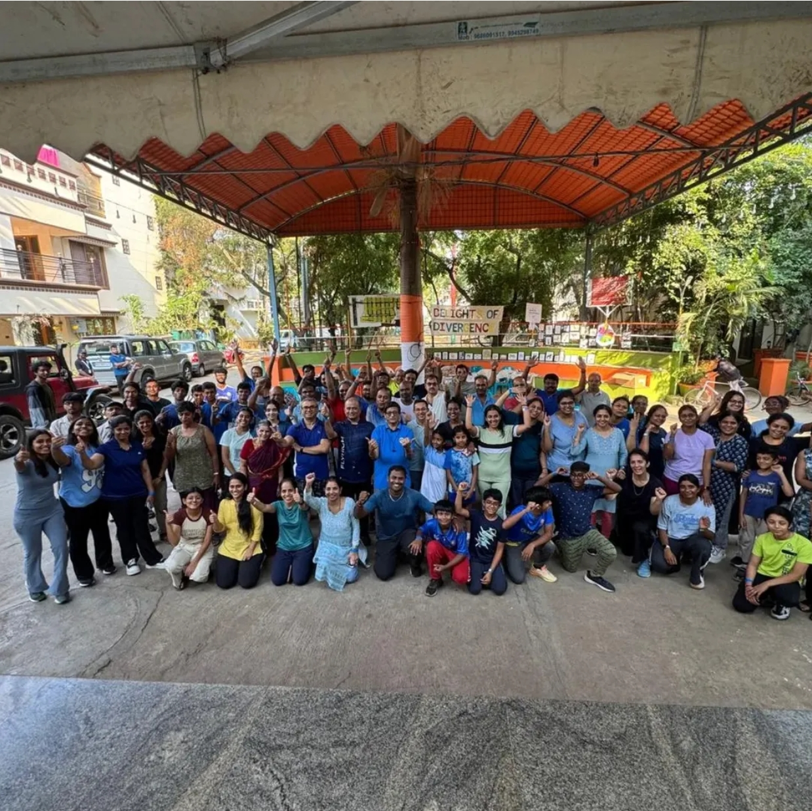

Some ideas do more than surprise you - they make you see things differently.

Two young women reached out to invite me to be part of an autism awareness event. I was pleasantly surprised. Most awareness efforts I’ve seen are driven by parents of autistic children. This felt different in two important ways—these were individuals not directly connected to autism, and they wanted us to come and engage, to talk, to build understanding.

They shared their plan: a “Run for Autism.” I was impressed.

There was something deeply ironic and powerful about it. In reality, many people tend to “run away” from autism. It asks for introspection, patience, and a willingness to understand differences. Often, both autistic individuals and their families experience isolation. And here were two young girls doing the opposite—not just running for autism, but bringing together a community of nearly 300 families to stand for a cause.

We started early this morning, leaving Farm Hill at 5 a.m. and reaching Himagiri Meadows by 6:30. What followed were meaningful conversations—with people connected to autism as family members, friends, or simply as curious, open individuals willing to learn.

I also learned more about the spirit behind this initiative. These young women were supported by their incredible fathers, who shared how their daughters spent nearly three weeks planning, encouraging participation, and even going door-to-door. Their pride was evident—and so well deserved.

The event itself was heartening. They raised a significant amount through registrations and donations. We had the opportunity to showcase our children’s work and connect with many people.

We left feeling immensely grateful—for the effort, the intention, and the possibility of a more aware and inclusive community.

@sambhavam.autism @autismparent 
@amautismawareness @inclusivesociety

::: {.page-cta}

#### Need support for your child?

Get in touch for expert help!

<a href="/contact" class="btn btn-primary">Contact Us</a>

:::