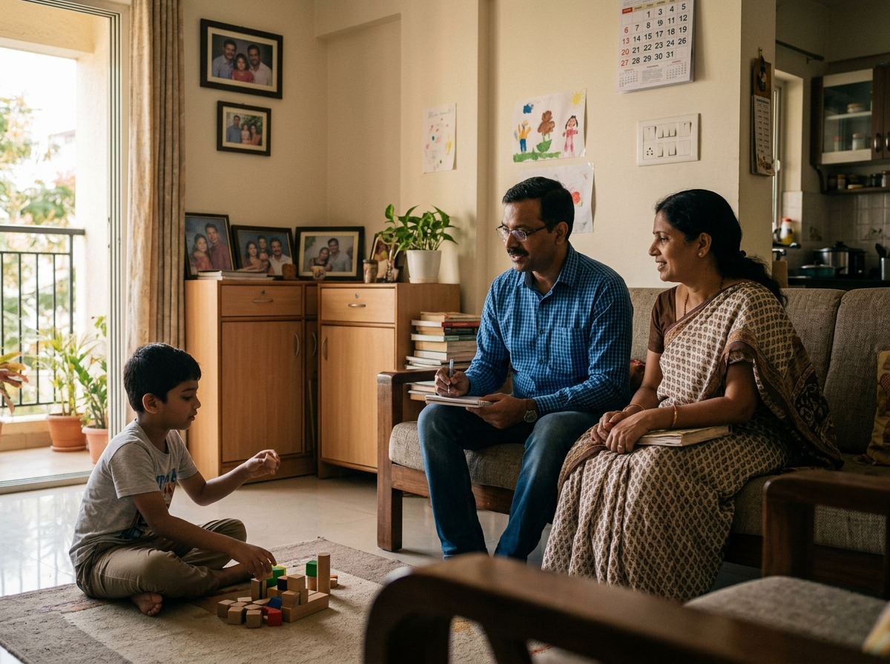

## The Hidden Gap in Early Intervention

In my years of practice, I have observed a recurring pattern in the way we approach early intervention for autism. A child is typically diagnosed around 2-3 years of age. The predominant early intervention model is an hour of therapy everyday or a few times a week. During these sessions, most autism specialists focus almost exclusively on working directly with the child to teach essential skills. While this is a standard starting point, many children quickly hit a plateau in learning and the families are left unsupported and underequipped.

The data, and my own clinical experience, show that child-led progress often stalls after the first year or two. By this time, the child turns about six years and the focus typically shifts toward school enrollment. While school has its benefits, it leaves a massive portion of the child’s day, and their long-term development, unsupported. You see a therapist for an hour a day for a therapy session but you are often left without a consultant to guide you through the other 23 hours of the day. This is the gap where many parents feel lost, and it is exactly where parent coaching steps in.

## Parent Coaching: A Crucial Category of Support

If you haven't heard the term "Parent Coaching" before, it is because it represents a new category of care. In my practice, I define this not as "treating the child," but as equipping the parent. My goal is to turn you into the primary expert on your child’s growth.

When I coach a parent, I provide three specific layers of support:

- **Perspective & Technical Skills:** I guide you on which skills actually matter for your child’s future and teach you the specific, technical methods to achieve them.
- **Emotional Support:** I serve as your safety net. Raising a child on the spectrum is an emotional marathon, and you need a space to process that weight.
- **Philosophical Support:** I help you frame your child’s development and your role within it, moving from a mindset of "fixing" to a mindset of "building."

## The Power of the Natural Environment

One of the most transformative aspects of my coaching model is that it happens where life happens - within your home. Traditional models often "alienate" the child by placing them in a sterile clinic where they perform tasks for a stranger in an artificial setting.

By coaching you in your own home, we preserve the natural environment. This is vital because:

- **Real-world integration:** Your child learns to navigate the home and school environments they actually live in.
- **Social continuity:** We don’t pull the child away from their life; they continue to learn while playing with their sibling, eating with the family, or relaxing in their room.
- **Preventing Alienation:** Instead of the child feeling like a "patient" in a clinic, they thrive within the existing family structure, guided by the people who love them most.

## A Story of Transformation: From Overwhelmed to Equipped

To understand the impact of this partnership, consider a mother I worked with recently. When we began, she was in a state of constant exhaustion. Her 8-yr old child on the spectrum was struggling with basic transitions—moving from playtime to the dinner table would trigger a forty-minute meltdown. Mealtimes had become a battlefield of sensory sensitivities and power struggles, leaving the mother feeling completely unable to de-escalate the situation or help her child regulate.
This was despite early intervention, support at school and everything that a typical family does for their child on the spectrum. 

We worked together consistently for about eight months. I didn't work with the child; I worked with the mother. I equipped her with the technical skills to anticipate triggers and the perspective to understand the "why" behind the behavior. Today, the dynamic has shifted entirely. The progress happened within their natural surroundings because the mother became the expert. The "downstream benefit" is that she no longer needs me to intervene in every crisis; she is now equipped to lead her child through whatever challenge comes next.

## The Lifecycle Perspective: Preparing for Adolescence and Adulthood

Parent coaching isn't just a temporary fix for early childhood; it is a solution for the entire life cycle of autism. I often see parents "outsource" their child’s development to a revolving door of therapists and schools during the early years.

The danger of this approach is that if you delegate the working relationship to others while your child is young, you will lose "access" to them when they hit the difficult teenage years. In India, there are very few specialists or facilities equipped to handle the complexities of autistic adolescents. If you haven't built that bridge of communication and influence now, you will find yourself with a teenager you cannot reach.

The Seeds of the Solution The solution to the problems of adolescence must be planted in childhood. By building a strong, direct working relationship through coaching today, you are ensuring that you have a path to influence and connect with your child when the stakes are much higher in the future.

## The Cautionary Tale: Certificates vs. Functional Skills

I am often reminded of my work with an NGO that supported adults aged 25 to 30. I met individuals who had successfully navigated the academic system and earned degrees, but only because their mothers had sat behind them for decades as "scribes," navigating every bureaucratic hurdle for them.

While these young adults had the paperwork of success, they lacked functional social skills and the practical abilities needed for a single day of independent living. This is the risk of focusing on the wrong milestones. Parent coaching ensures we don't just "get them through" the system, but that we focus on the functional, real-world skills that lead to true autonomy.

## Parent Coaching: A Proactive Choice for the Future

Choosing parent coaching is a shift from being a passive observer of your child’s therapy to becoming the empowered leader of their journey. It is about more than solving a behavior problem today; it is about building a sustainable, lifelong relationship. I encourage you to move from the sidelines and become the equipped participant your child needs. The work we do now is the foundation for everything they will become.
