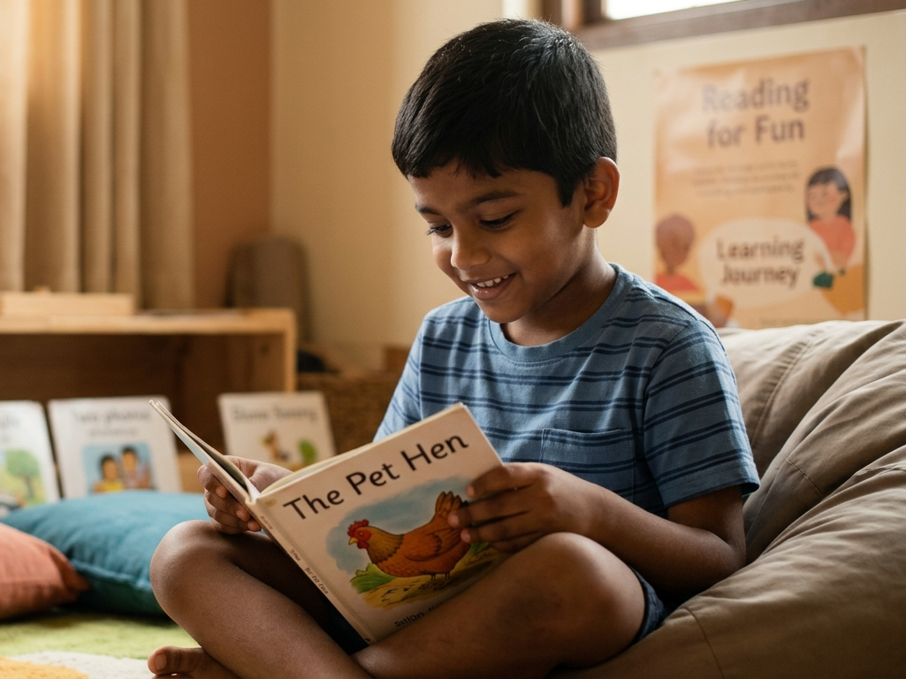

Individuals on the Autism spectrum seem to have very strong likes and dislikes. They get totally passionate about what they like and hate what they don't like completely.

One of the common interventions is desensitisation of aversive things so that it becomes bearable for the person. While this may work, it may end up in traumatising the person. It may cause anxiety and panic during the process.

We worked with a 7-year-old recently, who hated math and reading. He was attending a mainstream school until his parents brought him to us. He could communicate his likes and dislikes very clearly. His 'No' was a firm NO.

When we thought about his reading and math, we thought it could be lack of skill, lack of confidence, a bad learning experience or he just didn't relate to it.

We started with some fun activities for reading, introduced phonic way of reading which wasn't done before. We chose books which had lots of words based on phonetics. We read to him rather than asking him to read. We started with just one line and once he started looking at the book, slowly progressed from page to page. We did not challenge him or test him.

Somewhere, this made him neutral towards reading within a couple of weeks. Slowly, he started looking forward to the reading activity. As we moved from one book to another, he started asking to be read to him during his break time. He would remember the names of the books and ask. Finally, he started reading to himself. Books became one of his favourites.
Not only did he start to read on his own, but he also developed a positive attitude towards reading.

All this, within a span of eight weeks. This was so heartwarming to see.

