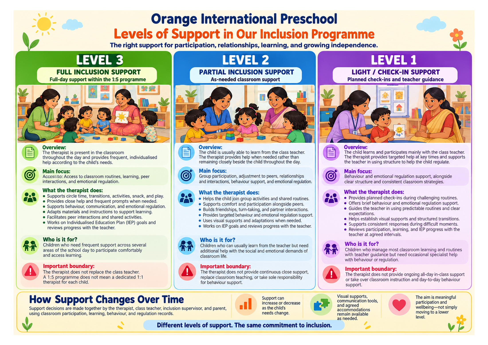

At Sambhavam, we support children’s communication, learning, independence and participation in everyday life. Through individual sessions, classroom inclusion, small-group learning and close collaboration with families, we work towards skills that make a meaningful difference in children’s lives. Our services are designed to support children with autism and other neurodevelopmental differences, as well as their families and communities.

## Early Intervention

### One-to-One Sessions

Our one-to-one sessions build a bridge between what a child can do today and their next steps in learning and everyday life. We plan around each child’s strengths, interests and support needs, with goals across the following areas.

#### Communication

We support children to bridge the gap between what they want to communicate and how they are able to express it—helping them share their needs, choices, ideas and experiences.

#### Classroom Learning

We build on what children can already do independently and provide support for the next step in their learning. Our focus is on helping them access classroom activities and develop greater confidence and independence as learners.

#### Emotional Regulation

We help children recognise and communicate distress, seek and accept support, and develop ways to feel more regulated. We also pay attention to the support they need from adults during difficult moments.

#### Leisure and Play

We help children discover activities they enjoy and build their ability to play or spend time independently, with support where needed. The aim is to create more opportunities for enjoyment, choice and self-directed activity.

#### Activities of Daily Living

We support children in developing skills for everyday routines and self-care. These are more than tasks to complete: they are opportunities for children to exercise choice, experience agency and become more independent in daily life.

#### Motor Skills

We support children to use their bodies to move, play, explore and solve problems, building foundations for increasingly complex skills as they grow.

#### Reading and Literacy

Our reading programme supports children as they learn to read, become more independent readers and understand what they read. Once a child begins reading, we weave reading into their language goals, connecting literacy with communication and continued academic learning.

#### Mathematics and Numeracy

Our mathematics programme begins with pre-number skills and building number sense. We help children move from concrete, hands-on learning towards understanding and applying more abstract mathematical concepts. The programme supports mathematical learning through the primary-school years.

### Small-Group Sessions

Our small-group sessions support children who find it challenging to join group activities in the classroom or participate in play with peers.

With guidance and opportunities to practise, children work on:

* Sharing materials and taking turns.
* Joining and playing with others.
* Managing the disappointment of losing a game.
* Listening to stories and participating in shared activities.
* Communicating and enjoying time with peers.

Our focus is on helping children develop the skills and confidence to participate in groups, with support that responds to their needs.

### Classroom Inclusion Support

Our classroom inclusion programme supports children to participate, learn and belong within an everyday classroom setting. Running from Nursery to UKG, the programme places a therapist within the classroom to support a small group of three to five children.

We work with the school curriculum, adapting activities, materials and support to make learning accessible to each child. We help children engage with classroom routines, shared materials, instructions and teachers, while continuing to receive the support they need.

The programme supports development across language, thinking and learning, physical skills, social participation, everyday independence and emotional development.

Classroom life is also about relationships and shared experiences. Children have opportunities to build friendships, sing, dance and play together, and participate in celebrations and presentations. Our goal is for children to become active members of their classroom community—not simply to be present in the room.

## Training & Support

### Parent Support and Collaboration

We work closely with parents to understand each child’s experiences across home, school and therapy.
Our monthly parent meetings provide time to share classroom observations, review progress and hear how children are doing in other settings. Together, we explore whether skills developed during sessions are becoming useful in everyday life and plan ways to support their use across different situations.
Parents’ observations, questions and priorities are an important part of this process. They help us develop a fuller understanding of the child and shape the next steps in our work.

### Workshops and Trainings

We consider ongoing learning an essential part of a therapist’s work.
Our therapists participate in monthly training sessions that explore aspects of psychology, behaviour and learning relevant to the children we support. These sessions help us develop a shared understanding, strengthen everyday practice and revisit our approaches with fresh attention.
Drawing on years of working with and learning from autistic children, we also conduct workshops for teachers, parents and special educators. These provide opportunities to share practical learning, explore questions together and strengthen the support available to autistic children in their classrooms, homes and communities.

::: {.page-cta}

#### Need support for your child?

Get in touch for expert help!

<a href="/contact" class="btn btn-primary">Contact Us</a>

:::